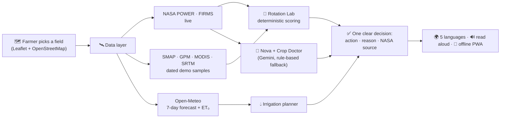

<div align="center">

# 🌱 AgroNova — AI Farm Companion

**NASA satellite data → one clear crop decision for smallholder farmers.**

[](https://www.spaceappschallenge.org/2026/find-a-team/vision-x1/)
[](https://www.spaceappschallenge.org/2026/find-a-team/vision-x1/)
[](#-multilingual-by-design)
[](#-works-on-patchy-connections)

[▶ Watch the 4-minute demo](https://youtu.be/vHx3dktcqK4) ·
[🛰️ Space Apps project page](https://www.spaceappschallenge.org/2026/find-a-team/vision-x1/) ·
[🚀 Live demo](https://YOUR-DEPLOYED-URL.vercel.app/demo)

</div>

---

## 🌾 The problem

Monsoon cycles are shifting. Smallholder farmers face failed seasons, sudden droughts and unexpected pest outbreaks, and the satellite data that could help is locked behind complex science and English-only tools.

## 💡 Our solution

**AgroNova** is a climate-adaptation companion that translates open NASA Earth observation data into simple, actionable agronomic decisions.

1. **Pick a field** on the map.
2. AgroNova reads **NASA POWER, GPM, SMAP and MODIS** data for that location.
3. The **Rotation Lab** ranks crop plans, each with **the action, the reason and the NASA source**.
4. Advice arrives in **five languages**, can be **read aloud**, and works on **patchy connections**.

---

## ✨ Features

| | Feature | What it does |
|---|---|---|
| 🔄 | **Rotation Lab** | Ranks three deterministic crop-rotation plans (Water-Saver, Climate Resilience, High Yield), balancing soil nutrients with Liebig's Law of the Minimum. |
| 💧 | **7-day irrigation planner** | Combines forecasts and reference evapotranspiration (ET₀) into a daily irrigation deficit. |
| 🩺 | **Crop Doctor** | Photo and symptom check for plant problems, with disease-prevention guidance. |
| 🗣️ | **Nova, the AI agronomist** | Voice and chat assistant that answers in the farmer's own language. |
| 🔥 | **Fire and heat awareness** | NASA FIRMS active-fire detection for crop-residue burns and heat protection. |
| 🌦️ | **Field-level risk advice** | Heat, spray-wind and fungal-risk guidance from daily NASA POWER readings. |
| 🗺️ | **Field picker** | Interactive Leaflet and OpenStreetMap map with GPS coordinates and place search. |

### 🌍 Multilingual by design

🇬🇧 English · 🇧🇩 বাংলা · 🇮🇳 हिन्दी · 🇪🇸 Español · 🇰🇪 Kiswahili

Full-interface translation plus read-aloud, so advice is usable by farmers who prefer listening to reading.

### 📶 Works on patchy connections

AgroNova ships as a **PWA with offline caching**, and Nova falls back to a built-in rule-based advisor when the AI service is unreachable.

---

## 🛰️ NASA data we use

We label exactly which data is live and which is a dated demo sample, so judges can check it against the demo.

| Dataset | Used for | Status in the demo |
|---|---|---|
| [**NASA POWER**](https://power.larc.nasa.gov/) (Agroclimatology Daily API) | Temperature, rainfall, humidity, solar radiation, wind, dew point and evapotranspiration, which drive irrigation, heat, spray-wind and fungal-risk advice | 🟢 Live |
| [**NASA SMAP**](https://smap.jpl.nasa.gov/) (L3 Enhanced Passive Soil Moisture) | Surface soil moisture (0.21 m³/m³ for the demo field) feeds the Rotation Lab water-fit score | 🟡 Dated demo sample |
| [**NASA GPM IMERG**](https://gpm.nasa.gov/data/imerg) | 30-day accumulated rainfall (42 mm for the demo field) feeds the rainfall score | 🟡 Dated demo sample |
| [**NASA MODIS / VIIRS**](https://modis.gsfc.nasa.gov/) | Vegetation condition index (0.61 for the demo field) shows crop vigour | 🟡 Dated demo sample |
| [**NASA SRTM**](https://www.earthdata.nasa.gov/data/instruments/srtm) | Elevation (18 m for the demo field) gives drainage context | ⚪ Static demo sample |
| [**NASA FIRMS**](https://firms.modaps.eosdis.nasa.gov/) (VIIRS and MODIS active fire) | Fire-anomaly detection near the field | 🟢 Live when a `VITE_FIRMS_MAP_KEY` is configured |

**Other open data and libraries:** [Open-Meteo](https://open-meteo.com/) (ECMWF IFS 7-day forecast and reference ET₀) · [OpenFarm](https://openfarm.cc/) (crop growth guides) · [OpenStreetMap](https://www.openstreetmap.org/copyright) and Nominatim (tiles and place search) · [Leaflet](https://leafletjs.com/) (maps)

---

## 🧠 How it works



### 🔍 Responsible use of AI

- **Rotation scores are deterministic code, not AI.** The same field and data always give the same ranking, and every recommendation cites its NASA source.
- **Google Gemini (`gemini-1.5-flash`)** powers only the Nova chat assistant, the Crop Doctor image check and the advisory wording. It sees the farmer's field details (location, crop, selected rotation), NASA POWER readings and any photo the farmer chooses to upload.
- **A rule-based fallback** answers when the AI is unavailable.

---

## 🚀 Quick start

```bash
# 1. Clone
git clone https://github.com/Fardinfn74/agronova-ai.git
cd agronova-ai

# 2. Install
npm install

# 3. Configure
cp .env.example .env      # then fill in your keys (see below)

# 4. Run
npm run dev
```

Open **http://localhost:8080** for the landing page and **http://localhost:8080/demo** for the farmer workspace.

### Environment variables

```env
VITE_SUPABASE_PROJECT_ID=your_project_id
VITE_SUPABASE_URL=https://your-project.supabase.co
VITE_SUPABASE_PUBLISHABLE_KEY=your_publishable_key

# Optional: enables live NASA FIRMS fire detection
# VITE_FIRMS_MAP_KEY=your_key
```

> See `.env.example` for the complete list, including the AI service key.

---

## 🛠️ Tech stack

| Layer | Tools |
|---|---|
| App framework | TanStack Start · TanStack Router · React 19 · TypeScript |
| Styling | Tailwind CSS v4 · Lucide icons · claymorphism design system |
| Maps and charts | Leaflet · Recharts |
| Backend and data | Supabase · Drizzle ORM · Nitro |
| Tooling | Vite 8 |
| AI | Google Gemini (in-product) |
| Fonts | Fraunces · Work Sans · Noto Sans Bengali (SIL Open Font License) |

---

## 👥 Team Vision X

| Name | Role | Affiliation |
|---|---|---|
| **Al Wahed Fardin** | Team lead | UITS |
| **Md. Ahnaf Tahmid Nafi** | Data scientist | GUB |
| **Abrar Sahriar Khan** | Researcher | UITS |
| **Ramisa Anjum Simi** | Designer | UITS |
| **Ramis Fariha Bhabna** | Presenter / storyteller | UITS |
| **Erina Siddiqua Eram** | Researcher | UITS |

Built for **NASA International Space Apps Challenge 2026, Bangladesh**, in the **Field Shift: Adapting Farms with NASA Data** challenge.

---

## 🤖 AI use in building this project

- **ChatGPT and Claude** helped with the video and image production (scene design, timing, subtitles, voiceover fitting), the presentation slides and the wording of the submission form.
- **Google Antigravity and Jules** worked on the codebase, repository and our own demo data.
- **ElevenLabs** generated the voiceover.

## 📚 References

- Liebig's Law of the Minimum, the nutrient-limiting principle behind the Rotation Lab scoring.
- NASA, Open-Meteo, OpenFarm, OpenStreetMap and Leaflet, as linked in the data tables above.

## 🙏 Acknowledgements

Thanks to NASA and its Earth science teams for open data, the NASA Space Apps organisers and our Local Lead, and the open-source communities behind every library we used.

<div align="center">

**🌍 Open satellite data should help the people who grow our food.**

</div>
